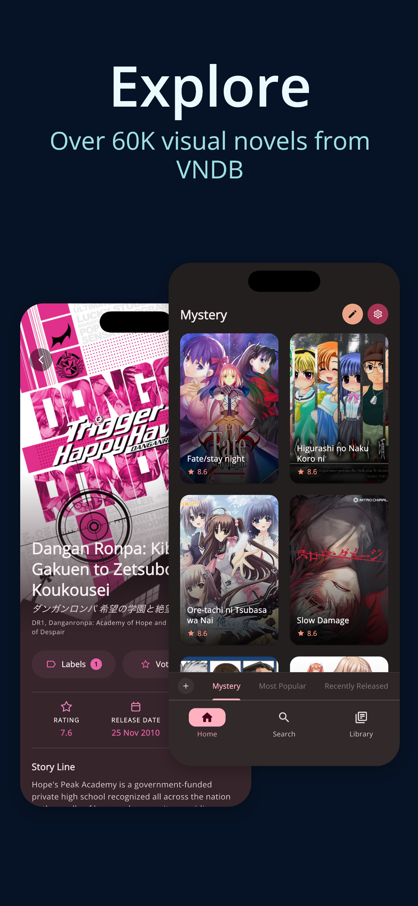
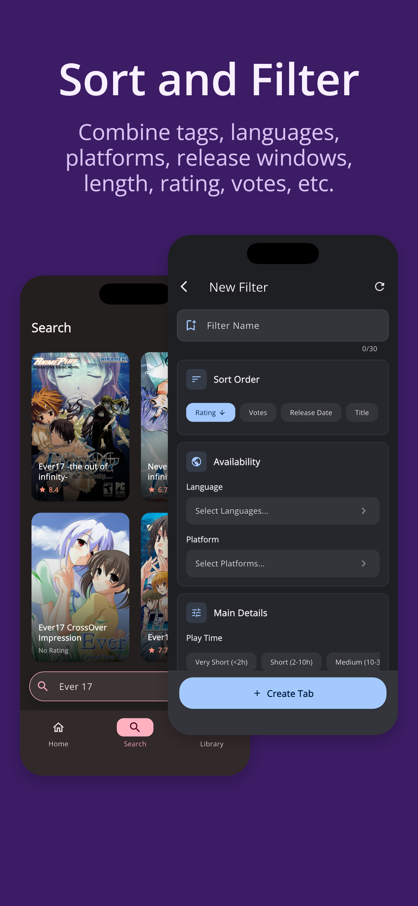
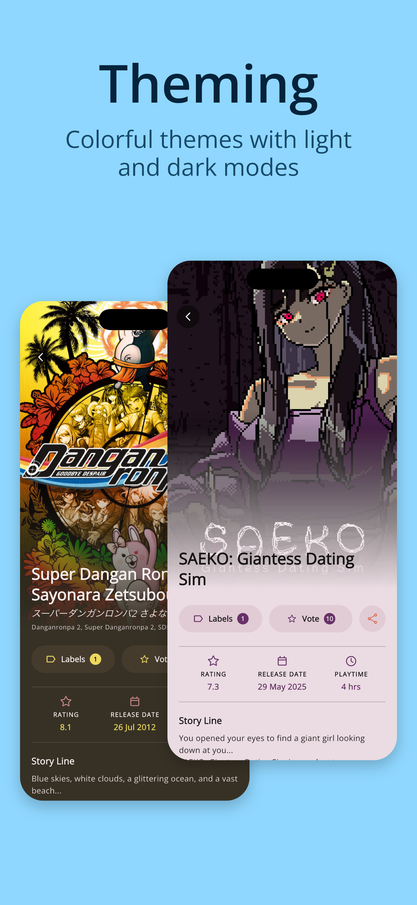
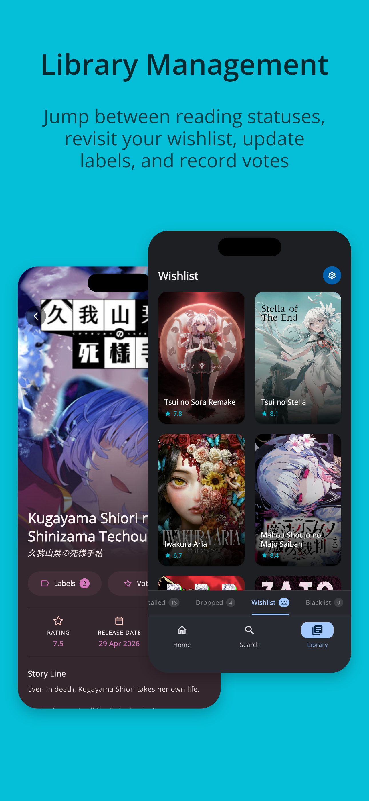

# Visual Novel Observatory

Visual novel tracking and discovery client for Android and iOS syncing seamlessly with [VNDB.org](https://vndb.org/). Browse, search, filter, and catalog visual novels.

---

## Screenshots

<div align="center">
  
  
  
  
</div>

---

## Key Features

- **VNDB Profile Sync**: Securely connect using your VNDB API Token. Sync and manage your visual novel lists (e.g., Playing, Finished, Stalled, Dropped, Wishlist) and save ratings.
- **Advanced Filtering & Sorting**: Filter visual novels by language, platform, development status, duration class, tags, and minimum rating or vote count.
- **Sensitive Content Blurring**: NSFW/explicit images are programmatically blurred, and sexual/erotic tags are automatically filtered out when explicit content settings are disabled.
- **Celestial Visual Design**: Sleek dark and light modes, customizable color themes (teal, gold, violet, etc.), and an OLED "True Black" option.
- **Offline Cache**: Automatically caches user lists and label data locally using Hive for fast load times and offline availability.

---

## Tech Stack & Core Libraries

- **State Management**: [Flutter Riverpod](https://pub.dev/packages/flutter_riverpod) for reactive, modular state tracking.
- **Navigation**: [GoRouter](https://pub.dev/packages/go_router) for declarative, type-safe path routing.
- **Local Database**: [Hive](https://pub.dev/packages/hive) for high-performance key-value database caching.
- **Network Images Caching**: [Cached Network Image](https://pub.dev/packages/cached_network_image) for optimized image loading and bandwidth reduction.
- **Data Serialization**: [Freezed](https://pub.dev/packages/freezed) and [Json Serializable](https://pub.dev/packages/json_serializable) for robust model codegen.
- **URL Launcher & Sharing**: [Url Launcher](https://pub.dev/packages/url_launcher) and [Share Plus](https://pub.dev/packages/share_plus) for external integrations.

---

## Getting Started

### Prerequisites
- Flutter SDK (latest stable release)
- Dart SDK

### Installation

1. Clone the repository and navigate to the project directory:
   ```bash
   git clone https://github.com/benjamindean/visual-novel-observatory.git
   cd visual_novel_observatory
   ```

2. Retrieve project dependencies:
   ```bash
   flutter pub get
   ```

3. Run code generation (for Freezed data models):
   ```bash
   dart run build_runner build --delete-conflicting-outputs
   ```

4. Run the application locally in debug mode:
   ```bash
   flutter run
   ```

---

## Contribution Instructions

We welcome contributions to Visual Novel Observatory! To maintain a premium user experience and clean code quality, please follow these guidelines:

### 1. Repository & Architectural Patterns
- **MVVM Boundary**: Keep visual layout code (Screens/Widgets) completely decoupled from state and data layers. Use Riverpod providers (`StateNotifierProvider`, `NotifierProvider`, etc.) for logic.
- **Screen Directory Isolation**: All screens must be housed in their own subdirectory under `lib/vn/screens/` or `lib/settings/screens/` alongside any local widgets unique to that screen.
- **Conditional Branch Extraction**: If a `build` method has conditional branches (like error banners, loading indicators, or auth check views) returning large layout widgets, extract each branch into a separate, focused widget class in a separate file.
- **Widget Atomicity**: Keep widgets small and focused on a single responsibility. Avoid giant build trees.

### 2. Styling & Formatting Rules
- **Trailing Commas**: Always end arguments, parameters, and lists with a trailing comma to ensure unified auto-formatting.
- **Variable Declarations Spacing**: Leave an empty line after declaring variables or conditional check blocks before writing the main logic.
- **Theme Color Tokens**: Never use hardcoded colors (`Colors.white`, `Colors.black`, etc.). Always reference theme context extensions (e.g. `context.appBackground`, `context.appTextPrimary`).
- **Material Splash Effects**: Interactive components (`ListTile`, `CheckboxListTile`, etc.) require a `Material` ancestor to display ink ripple animations correctly.

### 3. Verification Commands
Before submitting your changes, verify that your code compiles, formats, and analyzes cleanly:

1. **Format Code**:
   ```bash
   dart format lib/
   ```
2. **Static Analysis**:
   ```bash
   flutter analyze
   ```
3. **Trigger Code Generation (if data models changed)**:
   ```bash
   dart run build_runner build --delete-conflicting-outputs
   ```
